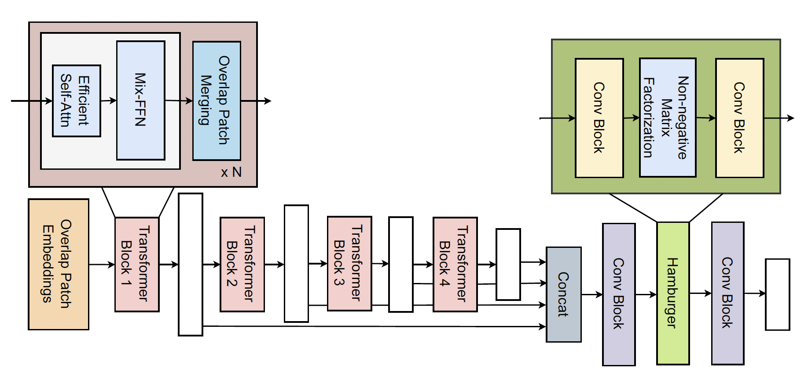

<div align="center">

<h1>Gasformer</h1>
<h3>A Transformer-based Architecture for Segmenting Methane Emissions from Livestock in Optical Gas Imaging</h3>

[Toqi Tahamid Sarker](https://scholar.google.com/citations?hl=en&pli=1&user=i1SmuwYAAAAJ)<sup>1</sup>, [Mohamed G. Embaby](https://scholar.google.com/citations?hl=en&user=N4Pc3A0AAAAJ)<sup>2</sup>, [Khaled R. Ahmed](https://scholar.google.com/citations?user=FYKqgh4AAAAJ&hl=en)<sup>1</sup>, [Amer AbuGhazaleh](https://scholar.google.com/citations?hl=en&user=FxqWjHsAAAAJ)<sup>2</sup>

<sup>1</sup> School of Computing, <sup>2</sup> School of Agricultural Sciences, Southern Illinois University Carbondale

**CVPR 2024 Workshops (Vision4Ag)**

[](https://arxiv.org/abs/2404.10841)
[](https://openaccess.thecvf.com/content/CVPR2024W/Vision4Ag/html/Sarker_Gasformer_A_Transformer-based_Architecture_for_Segmenting_Methane_Emissions_from_Livestock_CVPRW_2024_paper.html)
[](https://ieeexplore.ieee.org/abstract/document/10678016)
[](https://huggingface.co/datasets/toqi/Gasformer)
[](https://huggingface.co/toqi/Gasformer)
[](https://ai-greener-livestock.github.io/)

</div>

- [Abstract](#abstract)
- [Installation](#installation)
- [Dataset](#dataset)
- [Pretrained Weights](#pretrained-weights)
- [Training and Evaluation](#training-and-evaluation)
- [Citation](#citation)
- [License](#license)
- [Acknowledgments](#acknowledgments)

## Abstract

Methane emissions from livestock, particularly cattle, significantly contribute to climate change. Effective methane emission mitigation strategies are crucial as the global population and demand for livestock products increase. We introduce Gasformer, a novel semantic segmentation architecture for detecting low-flow rate methane emissions from livestock, and controlled release experiments using optical gas imaging. We present two unique datasets captured with a FLIR GF77 OGI camera. Gasformer leverages a Mix Vision Transformer encoder and a Light-Ham decoder to generate multi-scale features and refine segmentation maps. Gasformer outperforms other state-of-the-art models on both datasets, demonstrating its effectiveness in detecting and segmenting methane plumes in controlled and real-world scenarios. On the livestock dataset, Gasformer achieves mIoU of 88.56%, surpassing other state-of-the-art models.

<p align="center">
  
</p>

## Installation

**Step 1: Clone the Gasformer repository:**

To get started, first clone the Gasformer repository and navigate to the project directory:

```bash
git clone https://github.com/toqitahamid/Gasformer.git
cd Gasformer
```

**Step 2: Environment Setup:**

We recommend setting up a conda environment and installing dependencies via pip or conda. Use the following commands to set up your environment:

***Create and activate a new conda environment***

```bash
conda create -n gasformer python=3.8
conda activate gasformer
```

***Install PyTorch and CUDA***

```bash
conda install pytorch torchvision torchaudio pytorch-cuda=11.8 -c pytorch -c nvidia
```

***Install MMSegmentation dependencies***

```bash
pip install -U openmim
mim install mmengine
mim install "mmcv>=2.0.0"
```

***Install additional packages***

```bash
conda install conda-forge::ftfy
conda install conda-forge::tensorboard
pip install wandb
conda install anaconda::ipykernel
```

***Verification***

Gasformer is based on MMSegmentation 1.2.1, so we need to check the versions of PyTorch, MMCV and MMSegmentation.

```bash
python -c "import torch, mmcv, mmseg; print(torch.__version__, mmcv.__version__, mmseg.__version__)"
```

## Dataset

The data are on Hugging Face: [toqi/Gasformer](https://huggingface.co/datasets/toqi/Gasformer). It has two sets recorded with a FLIR GF77 camera.

| Name | Full name | Classes |
|---|---|---|
| `MR` | Controlled Methane Release | background and 10 flow-rate classes |
| `CR` | Dairy Cow Rumen Gas | background and gas |

The data are stored as Parquet. To write the PNG folders and the official split lists that the configs read, run

```bash
hf download toqi/Gasformer --repo-type dataset --local-dir gasformer_hf
pip install pyarrow
python tools/unpack_dataset.py gasformer_hf data MR CR
```

This creates `data/MR` and `data/CR`, each with `images/`, `masks/`, `train.txt`, `val.txt` and `test.txt`. The configs use `data_root='../data/MR/'` and `'../data/CR/'`. The splits are the ones used in the paper. We recommend splitting by video for new work, because neighbouring frames are nearly identical.

## Pretrained Weights

Checkpoints are on Hugging Face: [toqi/Gasformer](https://huggingface.co/toqi/Gasformer).

| Dataset | Checkpoint | Config |
|---|---|---|
| CR | `CR/CR_best_mIoU_iter_160000.pth` | `local_configs/gasformer/CR/gasformer-160k_CR-512x512.py` |
| MR | `MR/MR_best_mIoU_iter_160000.pth` | `local_configs/gasformer/MR/gasformer-160k_MR-512x512.py` |

```bash
hf download toqi/Gasformer --local-dir weights
python tools/test.py local_configs/gasformer/CR/gasformer-160k_CR-512x512.py weights/CR/CR_best_mIoU_iter_160000.pth
```

## Training and Evaluation

```bash
python tools/train.py local_configs/gasformer/MR/gasformer-160k_MR-512x512.py
python tools/test.py local_configs/gasformer/MR/gasformer-160k_MR-512x512.py <checkpoint.pth>
```

## Citation

If you use this code, the dataset or the checkpoints, you must cite the paper below.

```bibtex
@inproceedings{sarker2024gasformer,
  author    = {Sarker, Toqi Tahamid and Embaby, Mohamed G. and Ahmed, Khaled R. and AbuGhazaleh, Amer},
  title     = {Gasformer: A Transformer-based Architecture for Segmenting Methane Emissions from Livestock in Optical Gas Imaging},
  booktitle = {Proceedings of the IEEE/CVF Conference on Computer Vision and Pattern Recognition (CVPR) Workshops},
  month     = {June},
  year      = {2024},
  pages     = {5489--5497},
  doi       = {10.1109/CVPRW63382.2024.00558}
}
```

## License

The code is released under the [Apache License 2.0](LICENSE). The dataset and the checkpoints are released under [CC BY-NC 4.0](https://creativecommons.org/licenses/by-nc/4.0/). Commercial use of the data is not permitted.

## Acknowledgments

This work is supported by the project ["Artificial Intelligence for Greener Livestock: Educational and Research"](https://ai-greener-livestock.github.io/), award no. 2022-70001-37404, from the U.S. Department of Agriculture's National Institute of Food and Agriculture.

The code is based on SegFormer ([paper](https://arxiv.org/abs/2105.15203), [code](https://github.com/NVlabs/SegFormer)), Light-Ham ([paper](https://arxiv.org/abs/2109.04553), [code](https://github.com/Gsunshine/Enjoy-Hamburger/tree/main/seg_light_ham)) and [MMSegmentation](https://github.com/open-mmlab/mmsegmentation). We thank the authors for their work.
